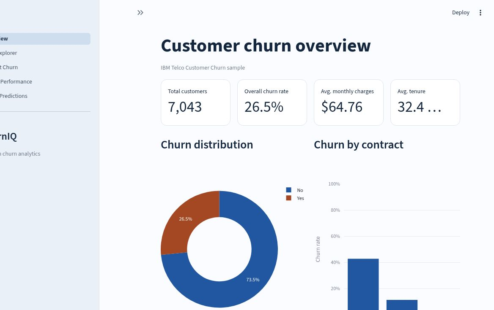
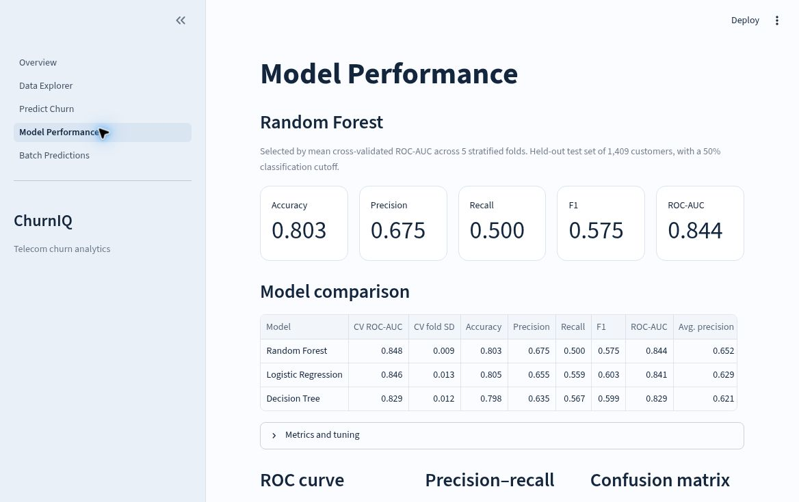

# ChurnIQ

ChurnIQ is a Streamlit portfolio project for exploring telecom customer churn, comparing classifiers, and scoring individual customers or CSV batches. The public IBM sample contains 7,043 customer records with 26.5% observed churn.

**Live demo** · [Open ChurnIQ](https://churniq-eurmtxhfc7qnwwwhmbs8ne.streamlit.app/)

**GitHub** · [Adnan-hamid-wani/churniq](https://github.com/Adnan-hamid-wani/churniq)

## Quick start

Use Python 3.12. From the repository root:

```bash
python3.12 -m venv .venv
source .venv/bin/activate
python -m pip install -r requirements.txt
python -m scripts.download_data
python -m streamlit run app.py
```

On Windows, create the environment with `py -3.12 -m venv .venv` and activate it with `.venv\Scripts\Activate.ps1` in PowerShell. Open `http://localhost:8501`. The included model and metrics let you launch without training. If the local CSV is absent, the analytics pages fetch the verified IBM snapshot on first use and cache it for the running process. Prediction pages load the fitted pipeline once per process and can run without data download.

## Dashboard

| Page | What you can do |
| --- | --- |
| Overview | Read customer, churn, billing and tenure KPIs and compare contract groups. |
| Data Explorer | Filter by contract, internet service and tenure. Compare distributions and group churn rates and inspect up to 50 rows without identifiers. |
| Predict Churn | Submit 19 customer fields and inspect probability, predicted class, risk category and input sensitivities. |
| Model Performance | See the measured model comparison, tuning parameters, test curves, confusion matrix and permutation importance. |
| Batch Predictions | Upload a UTF-8 CSV, preview up to 50 scores and download the complete results. |

For a batch demo, upload [the fictional customer example](docs/demo_batch.csv). Every input column from the in-app header template must be present. Order is flexible and extra columns are ignored. Use unique, nonempty `customerID` values and keep leading zeroes in the CSV. Blank features are imputed. Nonblank numeric values must be finite and nonnegative, and tenure must be integral. Unknown categorical levels are accepted and flagged, and their one-hot block becomes all zeros. Invalid CSV formatting and unsupported inputs yield an error with guidance. The export contains only `customerID`, `predicted_class`, and `predicted_probability`. The app holds uploaded results in session memory and does not write uploaded files to the repository. Use only fictional examples in a public demo.

## Dataset and attribution

IBM published the [21-column Telco Customer Churn CSV](https://github.com/IBM/telco-customer-churn-on-icp4d/blob/master/data/Telco-Customer-Churn.csv) with its archived [IBM Cloud Pak for Data Code Pattern](https://github.com/IBM/telco-customer-churn-on-icp4d). IBM's README declares Apache 2.0 for the code pattern. The CSV page provides no separate dataset license notice. ChurnIQ references and fetches the IBM copy and excludes that CSV from version control. The shipped artifacts are a fitted classifier and aggregate evaluation results, without embedded customer rows or IDs.

To download manually, open the IBM CSV page, click **Download raw file**, and save the file as `data/raw/Telco-Customer-Churn.csv`. Verify the bytes with `sha256sum data/raw/Telco-Customer-Churn.csv` (Windows PowerShell supports `Get-FileHash`). The expected SHA-256 is:

```text
16320c9c1ec72448db59aa0a26a0b95401046bef5d02fd3aeb906448e3055e91
```

The source schema includes customer, service, billing and account features. The label is `Churn` (`Yes` or `No`). The 11 blank total charges become missing numerical values. The loader validates required fields, allowed source categories, labels and unique identifiers.

## Reproduce the results

```bash
python -m pip install -r requirements-dev.txt
python -m scripts.download_data
python -m src.train
python -m pytest -q
python -m jupyterlab
```

Open `notebooks/01_exploratory_data_analysis.ipynb` in JupyterLab. The notebook describes the full sample for portfolio exploration. The input features and grids are predefined in code. A future iteration using full-data plots to revise the model should use a fresh holdout for evaluation. Running training replaces the model and metrics together as a release pair. A SHA-256 link in the metrics catches mismatches. Load Joblib artifacts only from your own checkout or other trusted sources.

### Methodology

- Customer IDs are excluded and the binary target is separated before fitting.
- The stratified 80/20 split uses seed 42 and leaves 5,634 rows for training and 1,409 for testing.
- A `ColumnTransformer` imputes numeric medians and categorical modes and one-hot encodes categories. Logistic Regression also standardizes numeric features.
- Five-fold shuffled stratified grid search fits the entire pipeline within each training fold. The best mean validation ROC-AUC selects the final model. Each tuned estimator is refitted on the full training partition before diagnostic comparison on the same holdout.
- The class cutoff is fixed at 0.50. Low risk is below 0.30, medium is 0.30 to below 0.70 and high is 0.70 and above. These are demonstration thresholds independent of the class cutoff.
- Probability scores feed ROC-AUC, average precision, and the ROC and precision–recall curves. Accuracy, precision, recall, F1 and the confusion matrix use thresholded classifications.

### Measured results

| Model | CV ROC-AUC | Test ROC-AUC | Avg. precision | Accuracy | Precision | Recall | F1 |
| --- | ---: | ---: | ---: | ---: | ---: | ---: | ---: |
| Logistic Regression | 0.8463 | 0.8414 | 0.6292 | 0.8048 | 0.6552 | 0.5588 | 0.6032 |
| Decision Tree | 0.8289 | 0.8288 | 0.6211 | 0.7984 | 0.6347 | 0.5668 | 0.5989 |
| Random Forest | 0.8483 | 0.8438 | 0.6523 | 0.8034 | 0.6751 | 0.5000 | 0.5745 |

The Random Forest was selected on validation ROC-AUC. The margin over Logistic Regression was about 0.002, so treat the ranking as specific to this experiment. At the demo cutoff, the forest correctly flagged 187 churners, missed 187, flagged 90 customers who stayed and correctly classified 945 customers who stayed. Logistic Regression had higher recall and F1 at that cutoff. The machine-readable training record is [models/metrics.json](models/metrics.json).

### Explainability and limitations

Global importance measures the average decrease in held-out ROC-AUC after shuffling a feature eight times. Contract and tenure ranked highest. Related inputs can share importance, and permuting fields can generate unlikely combinations. For a single record, the app re-scores the customer after replacing one field at a time with its training median or mode. The signed score difference shows how the entered value affects this particular model comparison. The differences can overlap and neither method establishes a causal effect.

The IBM sample is a historical demonstration with no verified prospective prediction window. Performance may change for other providers, customer groups or periods. Scores are uncalibrated and carry uncertainty. Demographic fields and correlates can introduce disparities, which this project does not audit. A production rollout would need a time-based evaluation using features available at the decision date, calibration checks, subgroup analysis and business-driven threshold validation.

## Architecture

```text
app.py                    Streamlit navigation and styling
views/                    Overview, explorer, prediction, performance, batch
src/                      Schema, preprocessing, training, evaluation, inference, explanations
scripts/download_data.py  IBM snapshot download and validation
data/raw/                 Local dataset location, CSV ignored by Git
notebooks/                EDA and interpretation
models/                   Fitted pipeline and evaluation JSON
docs/                     Screenshots and fictional batch example
tests/                    Schema, inference, reproducibility and page tests
.github/workflows/         Python 3.12 CI
```

[Project explanation](PROJECT_EXPLANATION.md) · [Interview preparation](INTERVIEW_PREPARATION.md)

## Screenshots





## Publish on GitHub

Create an empty public repository named `churniq` in your GitHub account. Run these commands within the extracted project. Replace `YOUR_ACCOUNT` with your username or organization.

```bash
git init -b main
git add .
git status --short
git commit -m "Build ChurnIQ telecom churn portfolio project"
git remote add origin https://github.com/YOUR_ACCOUNT/churniq.git
git push -u origin main
```

Keep the fitted pipeline and its metrics in the same commit. The fitted forest is about 904 KiB compressed. The raw dataset, local environment, caches and generated predictions are ignored.

## Deploy on Streamlit Community Cloud

1. Push the repository to GitHub and open [Streamlit Community Cloud](https://share.streamlit.io/).
2. Connect your GitHub account and choose **Create app** and **Yup, I have an app**.
3. Select the `churniq` repository, branch `main`, and main file path `app.py`.
4. In **Advanced settings**, select Python 3.12. Leave secrets blank and select **Deploy**.
5. Confirm that the overview loads. Submit the default customer in **Predict Churn**, check that **Model Performance** shows the measured results, and upload `docs/demo_batch.csv` in **Batch Predictions** to verify the CSV download.
6. Open the resulting `.streamlit.app` URL in a signed-out browser to confirm public access. If you deploy a separate copy, update its demo and repository links in the README.

[Official Community Cloud deployment instructions](https://docs.streamlit.io/deploy/streamlit-community-cloud/deploy-your-app/deploy)
